<picture>
  <source media="(prefers-color-scheme: dark)" srcset="./assets/hero-dark.svg">
  <source media="(prefers-color-scheme: light)" srcset="./assets/hero-light.svg">
  
</picture>

  <a href="https://yusuke-hayashi.com/">Portfolio</a>
  ·
  <a href="https://haya-inc.co.jp/">Haya Inc.</a>
  ·
  <a href="https://zenn.dev/yhay81">Zenn</a>
  ·
  <a href="https://www.linkedin.com/in/yhay81/">LinkedIn</a>
  ·
  <a href="https://www.kaggle.com/yhay81">Kaggle</a>
  ·
  <a href="https://huggingface.co/yhay81">Hugging Face</a>
  ·
  <a href="https://orcid.org/0009-0008-1145-8072">ORCID</a>
  ·
  <a href="mailto:yusuke8h@gmail.com">Email</a>

I'm a software engineer in Tokyo. At [Haya Inc.](https://haya-inc.co.jp/), I help teams put AI into production. My recent open-source work focuses on tools for reading, editing, and translating the files people already use.

## Current projects

| Project | What you can do with it |
| --- | --- |
| **[Zumen](https://github.com/zumen-jp/zumen)** | Read and write Japanese CAD drawings and BIM models, including JWW, SXF, and IFC. Python, JavaScript, and .NET applications share the same Rust core. [Supported formats](https://zumen.dev/formats/) |
| **[pyropdf](https://github.com/yhay81/pyropdf)** | Extract text and tables, render a page as an image, or edit a PDF from Python. Group edits in a transaction so they can be undone together. [Documentation](https://pyropdf.haya.works/) |
| **[ParaPDF](https://github.com/yhay81/parapdf)** | Embed a PDF reader in a React app. It renders pages near the viewport as you scroll and supports text selection, search, and annotations. [Live demo](https://parapdf.yhay81.com/demo/) |
| **[VastGrid](https://github.com/yhay81/vastgrid)** | Open a large CSV or Parquet file as a spreadsheet and edit individual cells. Rows load as you scroll. The same grid runs in the browser, VS Code, and Jupyter. [Open a file](https://vastgrid.yhay81.com/open/) |

### Document tools for VS Code

- **[PDF Translation Viewer](https://github.com/yhay81/pdf-translation-viewer)** shows the original page beside its translation, keeping figures, tables, and equations in place.
- **[Markdown Translation Preview](https://github.com/yhay81/markdown-translation-preview)** aligns each translated paragraph with its source and preserves code blocks and link targets.
- **[PPTX Live Viewer](https://github.com/yhay81/pptx-live-viewer)** keeps the current slide in view when a script regenerates a PowerPoint file, so you can inspect changes as you work.

## Other selected work

- **[WasmHatch](https://github.com/haya-inc/wasmhatch)** is a browser-based AI assistant that analyzes spreadsheets and creates editable Google Docs, Sheets, and Slides. [Try it](https://wasmhatch.com/)
- **[HayaSend](https://github.com/haya-inc/hayasend)** provides a Resend-compatible email API that delivers through Amazon SES in the customer's own AWS account.
- **[Firsthand](https://firsthand.work/)** indexes jobs from employers' own sites and keeps a history of what changed in each listing.

## Research and open data

- **[ARC-AGI-2 Solution Atlas](https://github.com/yhay81/arc-agi-2-solution-atlas)** pairs each of the 1,120 public tasks with a runnable Python solution and an English explanation. A verifier checks the solutions against all 4,834 published input–output pairs.
- **Japan Municipal Open Data Atlas** brings official statistics together across 1,919 Japanese statistical area codes. Explore the data in the [Municipality Explorer](https://huggingface.co/spaces/yhay81/japan-municipality-explorer) or download it from [Kaggle](https://www.kaggle.com/datasets/yhay81/japan-municipal-open-data-atlas-2026) or [Hugging Face](https://huggingface.co/datasets/yhay81/japan-municipal-open-data-atlas-2026).
- In astronomy, I co-authored the [first data release of the Hyper Suprime-Cam Subaru Strategic Program](https://doi.org/10.1093/pasj/psx081). My publication record is on [ORCID](https://orcid.org/0009-0008-1145-8072), [Google Scholar](https://scholar.google.com/citations?user=A3mvIIUAAAAJ), and [researchmap](https://researchmap.jp/yhay81).

## Engineering footprint

  

First-party public GitHub signals, regenerated weekly with a versioned API and no coding-time vanity metrics.

## Latest writing

<!-- BLOG-POST-LIST:START -->
- [AIエージェントシステムの費用はどう決まる？API利用料から運用費まで](https://zenn.dev/yhay81/articles/202608-llm-api-cost-guide) — 2026-08-23
- [AIエージェントシステム観測の基本構造：費用・遅延・品質をつなぐ](https://zenn.dev/yhay81/articles/202608-llm-api-observability-guide) — 2026-08-23
- [LLM APIの提供経路を理解する：AWS・GCP・Azure・直API・AI Gatewayの違い](https://zenn.dev/yhay81/articles/202608-llm-api-landscape) — 2026-08-22
- [LLM APIの費用はなぜ増える？コスト構造と最適化の基本](https://zenn.dev/yhay81/articles/202608-llm-api-cost-guide-for-beginners) — 2026-08-22
- [LLM APIコスト最適化 実践教科書](https://zenn.dev/yhay81/books/llm-api-cost-optimization) — 2026-08-22
<!-- BLOG-POST-LIST:END -->

---

Outside work, I am usually on a road bike. For consulting, product engineering, or AI adoption inquiries, visit <a href="https://haya-inc.co.jp/">Haya Inc.</a> or <a href="mailto:yusuke8h@gmail.com">get in touch</a>.
